# pet_xiaoman（宠小满）· 业务流程总览 v1.1

> **文件名固定为 `_v1.0.md`**：它是全项目的流程侧入口，路径被其他文档引用，版本号只在标题与 §10 修订记录里滚动。
>
> **定位**：C 端小程序 + B 端管理后台的**业务流程图唯一汇编**。开发、测试、交接、需求评审都以本文件为流程侧入口。
> **事实源优先级**：代码 > PRD。凡两者不一致，本文件在 §9「PRD 与实现差异清单」中显式列出，**以代码为准**，并把差异回写 PRD 作为待办。
> **配套文档**：`pet_xiaoman_PRD_v1.2.md`（§6 业务流程 / §6.4 状态机为设计态原文）、`pet_xiaoman_技术选型方案_v1.1.md`（ADR-001~006）。
> **维护规则**：任何状态机、接口、页面流转变更，**同一提交内**更新本文件，并追加 §10 修订记录。

---

## 0. 阅读指引

### 0.1 角色与端

| 代号 | 角色 | 载体 | 权限边界（PRD §8.5） |
|---|---|---|---|
| 👤 | **宠物主**（客户） | 微信小程序 | 仅本人订单/宠物档案/寄存查询；可预约、可改期 1 次、可取消（限待确认/已预约） |
| 💻店员 | **门店店员** | Web 后台 | 订单状态**正向**流转、影像上传、改期、备注、到店付结清、寄存登记/续存/取回、回访登记；**不可**回退状态、不可撤回影像、不可改价格 |
| 💻店长 | **店长（老板）** | Web 后台 | 店员全部 + 影像撤回（强制原因留审计）+ 价格配置 + 全量手机号；**不可**配置本店品牌（见下） |
| 🛡️ | **平台超管** | 同一套 Web 后台 | 平台级（`staff.store_id = null`）：开通门店、启停门店、**统一配置所有门店的品牌与 UI**、为门店开通/停用/改密账号。**不做门店履约**——菜单里只有「门店管理」 |
| ⚙️ | **系统** | 后端 | 锁价快照、夜间单判定、SLA 计时、订单号生成、幂等落账 |

> **平台层 vs 门店层**：`staff.store_id` 为空 = 平台级，有值 = 门店员工。二者共用一套后台与登录接口，靠 `role` + RBAC 菜单/权限区分。
> ⚠️ **实现红线**：`tenant.store_clause()` 在 `store_id is None` 时**返回不过滤**（历史单店兼容留的口子），**这不是超管特权**。因此所有门店业务操作都必须在路径里显式带 `store_id`（见 `/api/b/platform/*`），绝不能靠「空的 store_id 就能看到全部」。

### 0.2 图例约定

- 🟢 **绿色节点** = 正常业务节点
- 🟠 **橙色节点** = 需人工决策/判断分支
- 🔴 **红色节点** = 异常/拒绝路径
- 🔵 **蓝色节点** = 系统自动处理
- 实线箭头 = 主流程；虚线箭头 = 异常/分支流程

### 0.3 本文件不包含

- 部署拓扑与运维流程（见 ADR-005 云托管部署清单）
- 前端组件级交互细节（见 `05-UI设计/`）
- 数据库 ER（见 `app/models/`，字段定义以 PRD §7.1 为基线）

---

## 1. 端到端全景流程

一张图看清一笔订单从「客户发现」到「回访闭环」的全生命周期，以及 C 端与 B 端在哪些点交接。

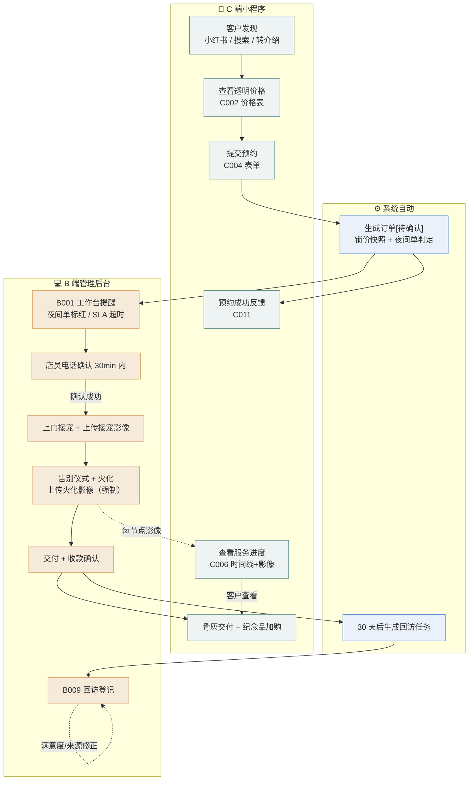

**关键交接点（3 个）**

| # | 交接 | C 端动作 | B 端动作 | 系统 |
|---|---|---|---|---|
| 1 | 预约 → 待确认 | 提交表单成功，拿到订单号 | 工作台 30 秒内可见，夜间单标红 | 锁价快照 `price_version`、夜间单判定 |
| 2 | 服务过程 → 信任传递 | 时间线刷新，看到每节点影像 | 上传接宠/告别/火化影像 | 强制影像校验拦截非法流转 |
| 3 | 交付 → 回访闭环 | 现场加购纪念品 | 标记结清、登记回访 | 完成满 30 天动态生成回访任务 |

---

## 2. C 端小程序业务流程

### 2.1 预约下单主流程（C002 → C004）

这是 C 端**最高价值**流程，也是校验最密的地方。后端 `order_service.create_order()` 有五道闸门，任一不过直接 422 拒绝。

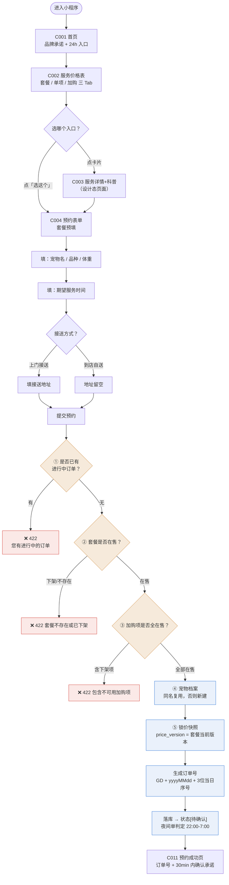

**接口**：`POST /api/c/orders`

**五道闸门细节**

| 闸门 | 规则 | 失败返回 |
|---|---|---|
| ① 重复单拦截 | 同客户存在 `待确认/已预约/接宠中/服务中/待交付` 任一状态即拒绝 | 422「您有进行中的订单，请联系门店处理」 |
| ② 套餐校验 | 必须存在、`type=PACKAGE`、`status=ON_SALE` | 422「套餐不存在或已下架」 |
| ③ 加购校验 | 逐个校验 `status=ON_SALE`，并落价格快照 | 422「包含不可用的加购项，请刷新后重试」 |
| ④ 宠物档案 | 同客户同名未删除档案直接复用，否则新建 | 无（自动） |
| ⑤ 锁价 | `price_version` 快照套餐版本号；`total_amount` = 套餐快照价 + Σ 加购快照价 | 无（自动） |

**订单号生成**：`GD{yyyyMMdd}{当日序号3位}`，如 `GD20260910001`。并发竞态由 `order_no` 唯一索引兜底，冲突时重生成重试 1 次。

### 2.2 支付三选一（C012 收银台）

PRD v1.3 设计了收银台三选一；当前已实现 C012 页面承载，但 `PAY_ENABLED` 默认 `false`，所以定金/全款为置灰预留态，仅「到店付款」可提交到 C011。

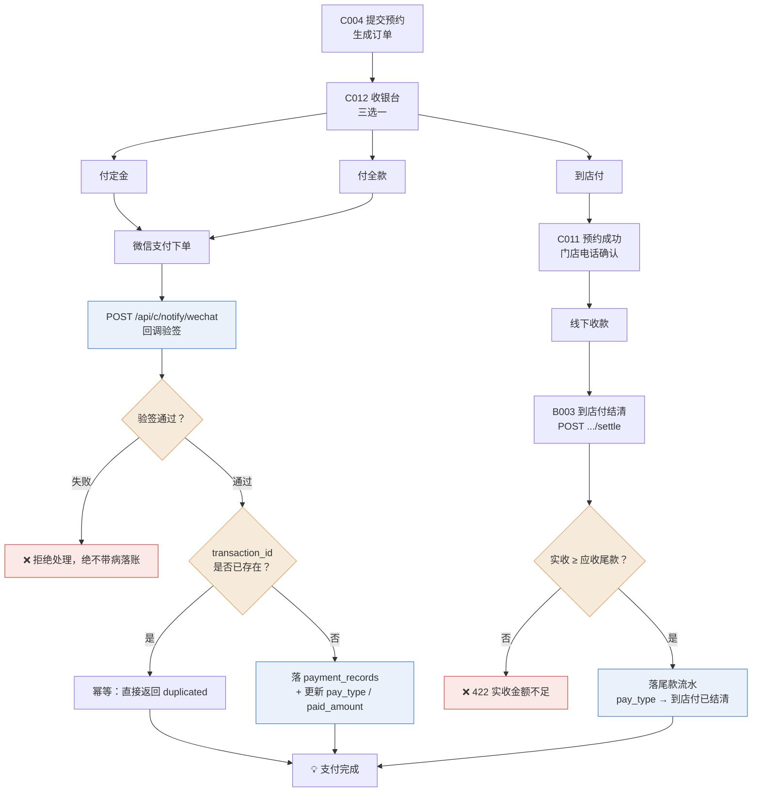

**支付子状态机（独立于订单主状态机）**

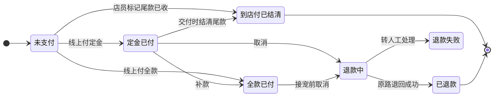

> ⚠️ **解耦要点**：支付子状态**不影响**预约与服务流转，只在「流转到已完成」时作为前置校验（必须 `全款已付` 或 `到店付已结清`）。这意味着客户可以先约后付、先服务后付，业务不会因为支付卡住。

### 2.3 查看服务进度（C006 时间线）

信任传递的核心载体——客户不用打电话问「我家宝贝现在怎么样了」，打开就能看到每节点影像。

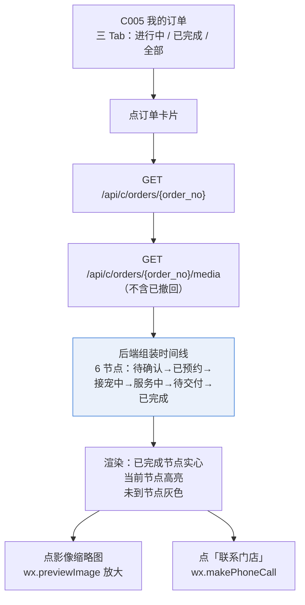

**时间线节点与影像的对应关系**

| 时间线节点 | 客户可见影像 | 影像节点枚举 | 是否强制 |
|---|---|:--:|:--:|
| 待确认 | — | — | — |
| 已预约 | — | — | — |
| 接宠中 | — | — | — |
| 服务中 | 接宠完成 | `PICKUP` | ✅ 强制 |
| 待交付 | 告别仪式 + 火化完成 | `FAREWELL` / `CREMATION` | ✅ 火化强制 |
| 已完成 | 交付完成 | `DELIVERY` | 否 |

### 2.4 客户取消订单

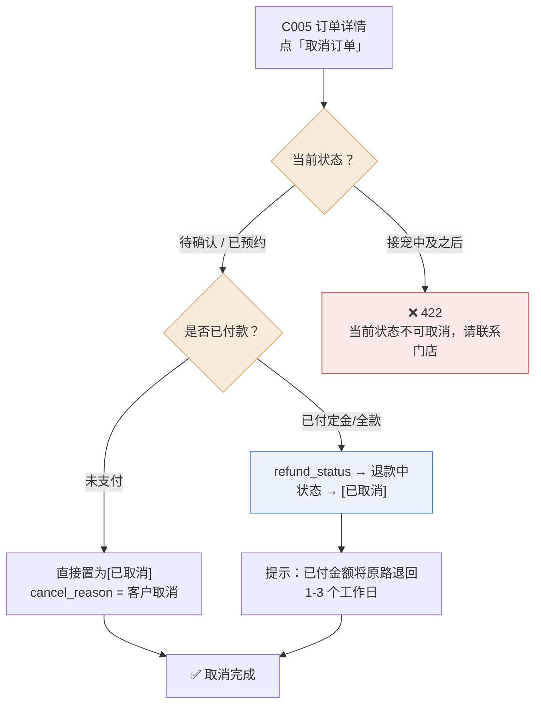

**接口**：`POST /api/c/orders/{order_no}/cancel`（客户侧仅这两个状态可取消，比 PRD 更严）

### 2.5 纪念品浏览与单件直购（C007）

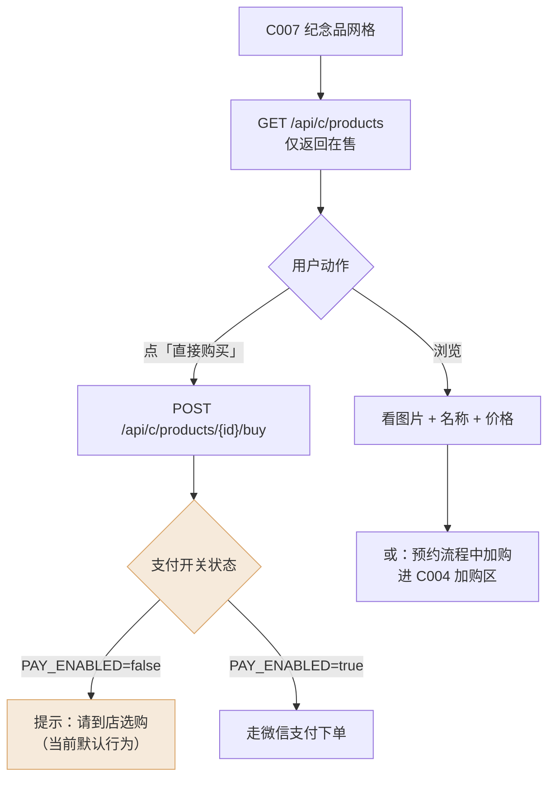

> 另一条加购路径在**交付环节**：店员在 B003 现场追加加购项，按追加时刻价格版本计价，追加后重算总额并推送客户确认（订阅消息）。

### 2.6 骨灰寄存查询（C008）

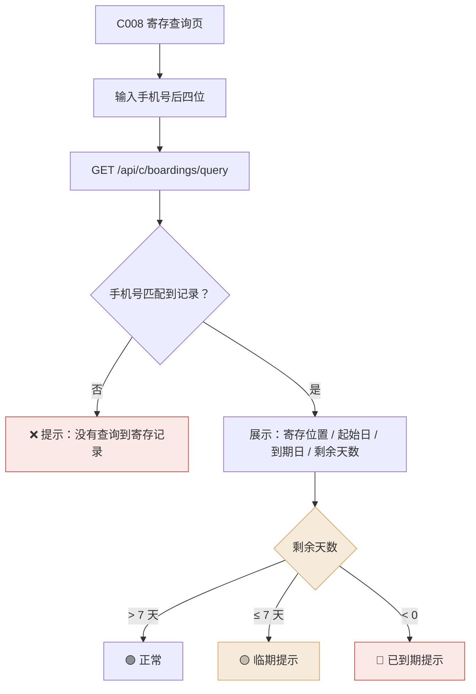

### 2.7 宠物档案（C009）

档案**不是**独立创建的，而是在下单时由系统自动建档/复用——这是减少客户填表负担的设计。

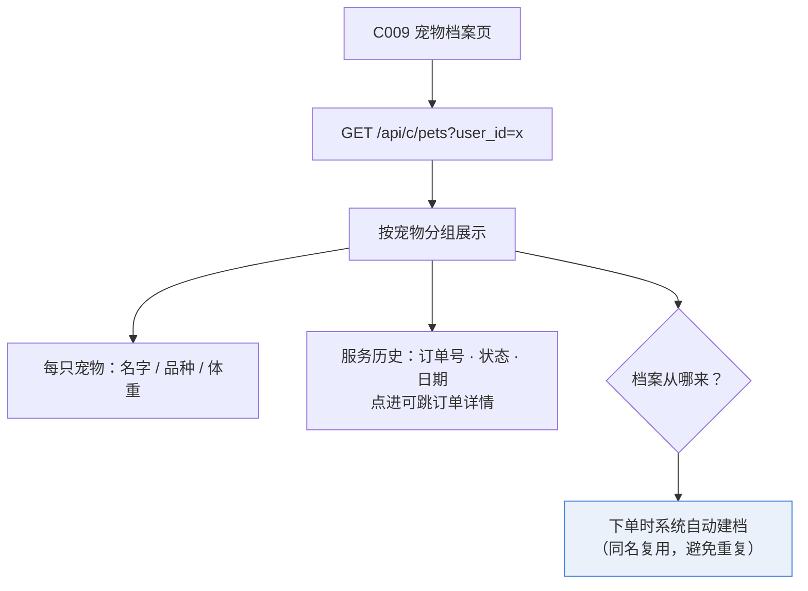

---

## 3. B 端管理后台业务流程

### 3.1 订单处理主流程（B001 → B002 → B003）

店员一天的主线：看工作台 → 进订单 → 按状态推进 → 上传影像 → 收尾结清。

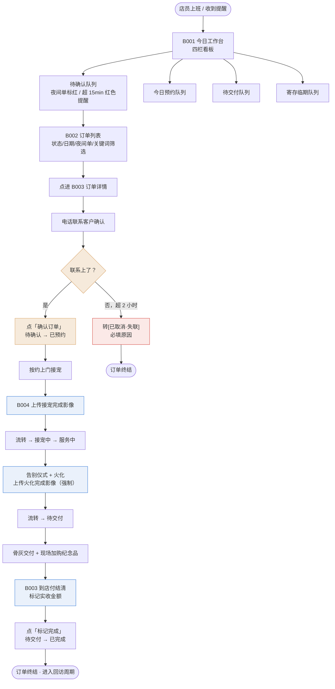

### 3.2 订单状态流转全景（状态机）

这是**全系统的中枢**。后端 `order_state.py` 的 `TRANSITIONS` 表是唯一真相，非法流转一律拒绝。

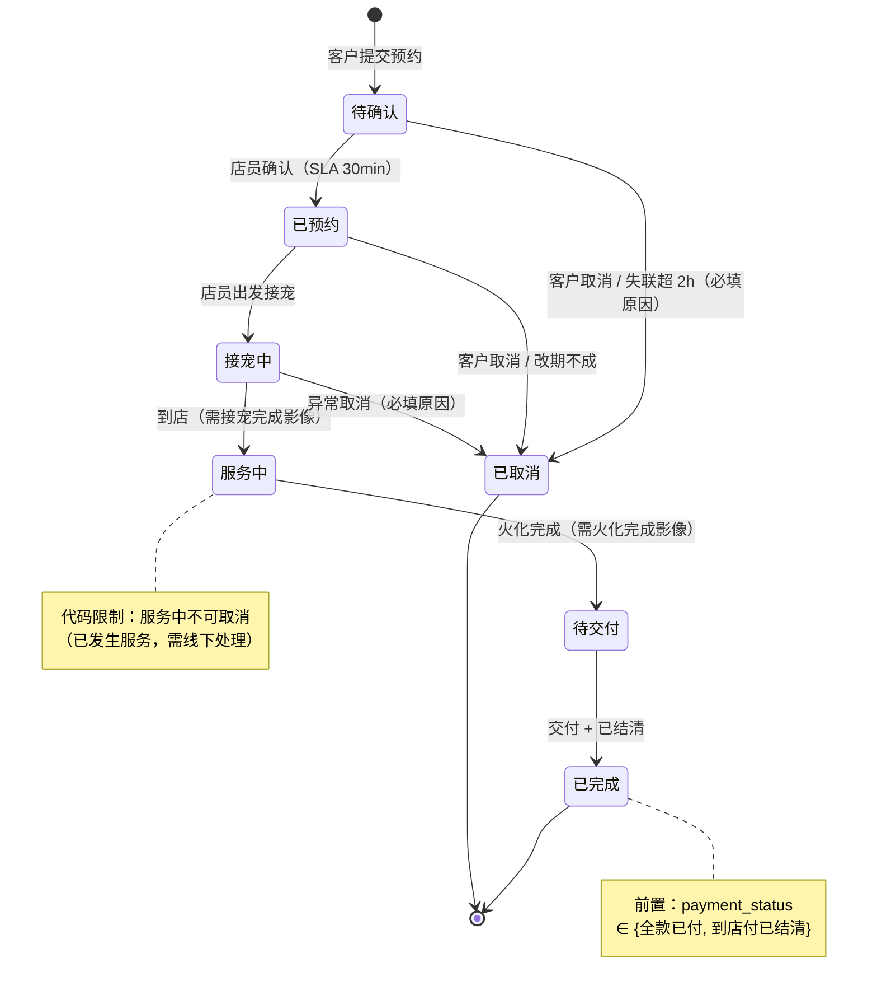

**合法流转表（与代码 `TRANSITIONS` 逐条对齐）**

| 当前状态 | 可流转至 | 前置条件 | 触发方 |
|---|---|---|---|
| 待确认 | 已预约 | 无 | 💻店员（SLA 30 分钟，超 15 分钟红色提醒） |
| 待确认 | 已取消 | 必填原因 | 👤客户 / 💻店员 |
| 已预约 | 接宠中 | 无 | 💻店员 |
| 已预约 | 已取消 | 必填原因 | 👤客户 / 💻店员 |
| 接宠中 | 服务中 | **需 `接宠完成` 影像 ≥1 张** | 💻店员 |
| 接宠中 | 已取消 | 必填原因 | 💻店员 |
| 服务中 | 待交付 | **需 `火化完成` 影像 ≥1 张** | 💻店员 |
| 待交付 | 已完成 | **`pay_type` ∈ {全款已付, 到店付已结清}** | 💻店员 |
| 已完成 | — | 终态 | — |
| 已取消 | — | 终态 | — |

> ⚠️ **逆向边全部不存在**：PRD §6.4 提到「已完成回退由店长操作并强制原因」，代码 `TRANSITIONS` 中**没有任何逆向边**，`order_service.transition()` 注释也明确写了「店长回退例外通道暂不实现」。这是 §9 差异项之一。

### 3.3 强制影像节点校验（B004）

影像不是「锦上添花」，而是**流转的硬门槛**。服务端查库校验，不信任前端的 `has_media` 参数——这是防作弊的关键设计。

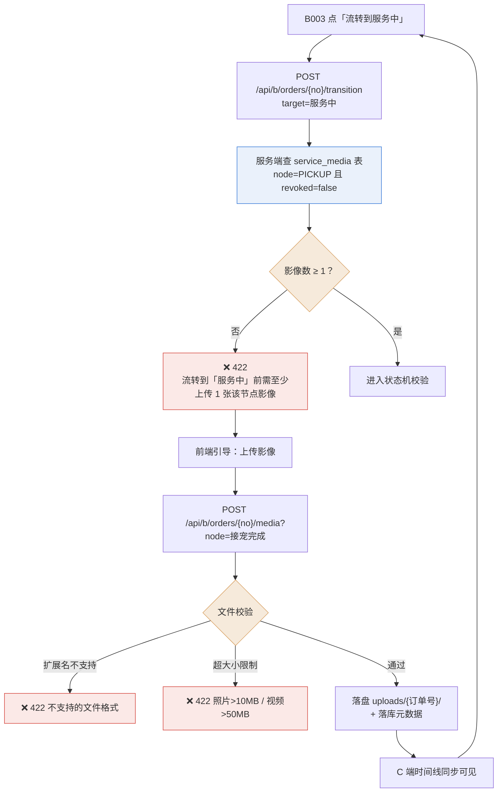

**影像规格约束**

| 类型 | 允许格式 | 大小上限 | 备注 |
|---|---|---|---|
| 照片 | `.jpg` `.jpeg` `.png` `.webp` | 10 MB | 客户端已压缩 |
| 视频 | `.mp4`（H.264） | 50 MB | iOS HEVC 由小程序端 `compressVideo` 预处理 |

**影像撤回（仅店长）**

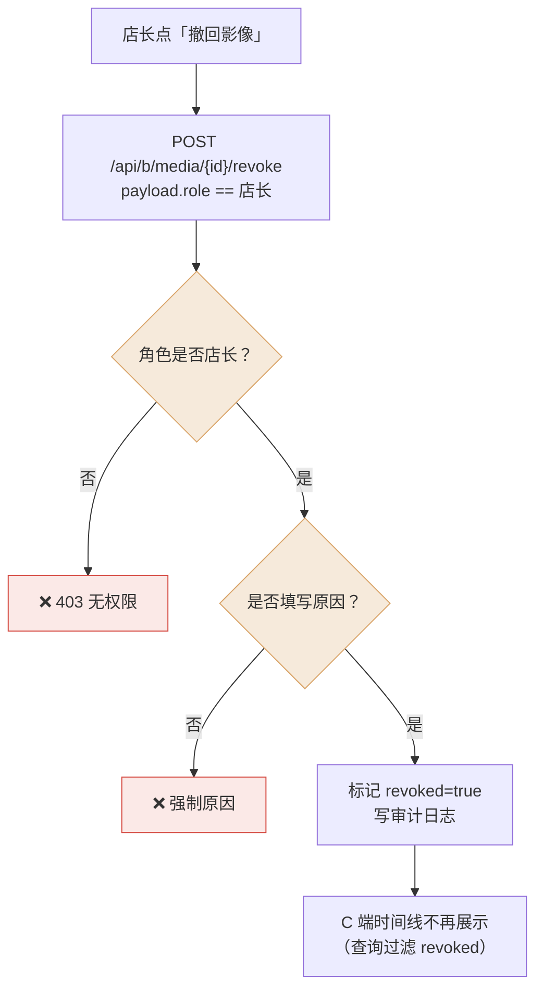

> ⚠️ **风险提示**：撤回首必须确认已经流转过——如果撤掉「接宠完成」影像后订单已在「服务中」，再想前滚到「待交付」不受影响，但若因故需要回退再前滚就会卡住。当前无回退边，所以不会出现这个死锁；一旦未来开放回退，**必须先补这个校验**。

### 3.4 客户改期（免费 1 次）

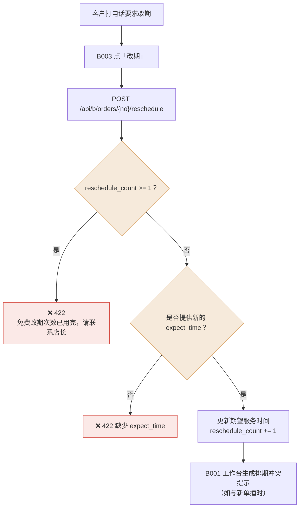

> 改期接口**不限状态**——只要 `reschedule_count < 1` 且订单存在即可改，包括已完成订单。这是一个潜在的口径漏洞，见 §9 差异项。

### 3.5 到店付结清（B003）

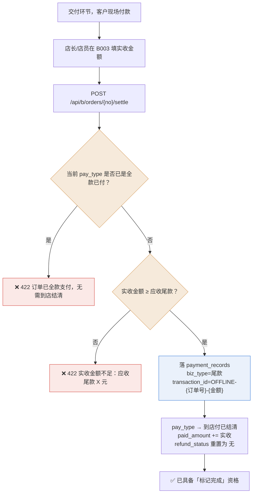

### 3.6 服务项目与价格版本化（B005）

**改价即新版本，历史订单不受影响**——这是锁价快照的上游保障，也是整个「透明价格」承诺的技术底座。

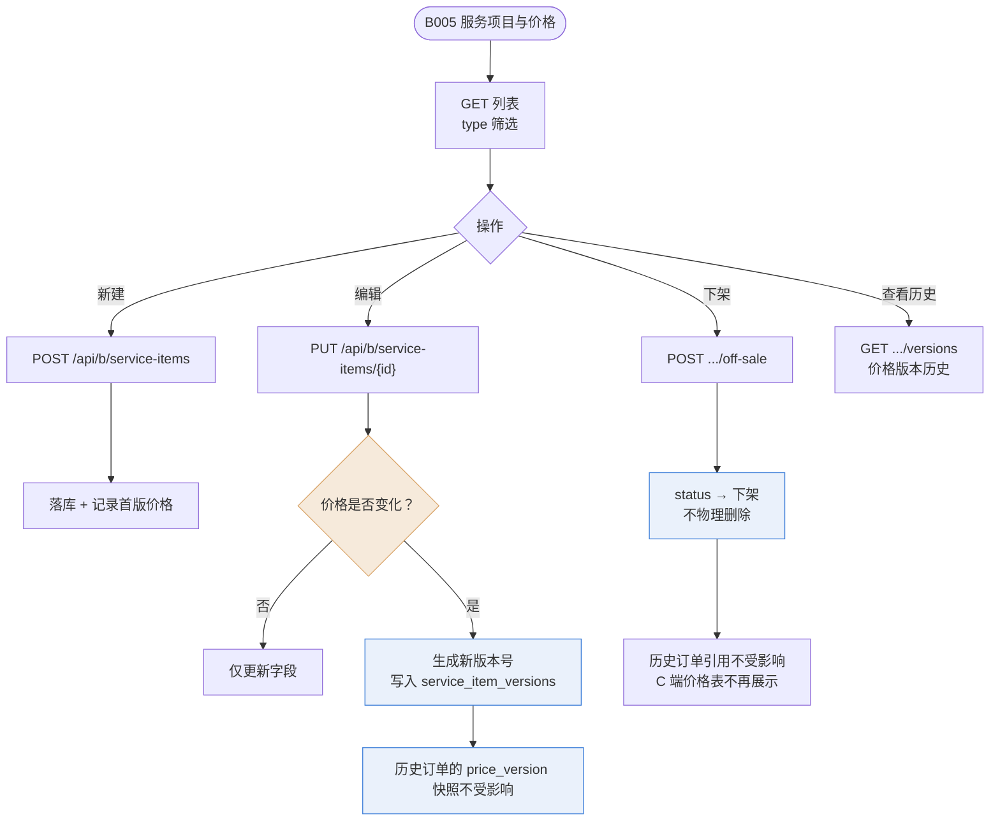

> **约束**：店员**不可**访问此模块（PRD §8.5），只有店长能改价格。这是权限矩阵里最硬的一条——价格是品牌承诺，不能让一线随手改。

### 3.7 纪念品管理（B006）

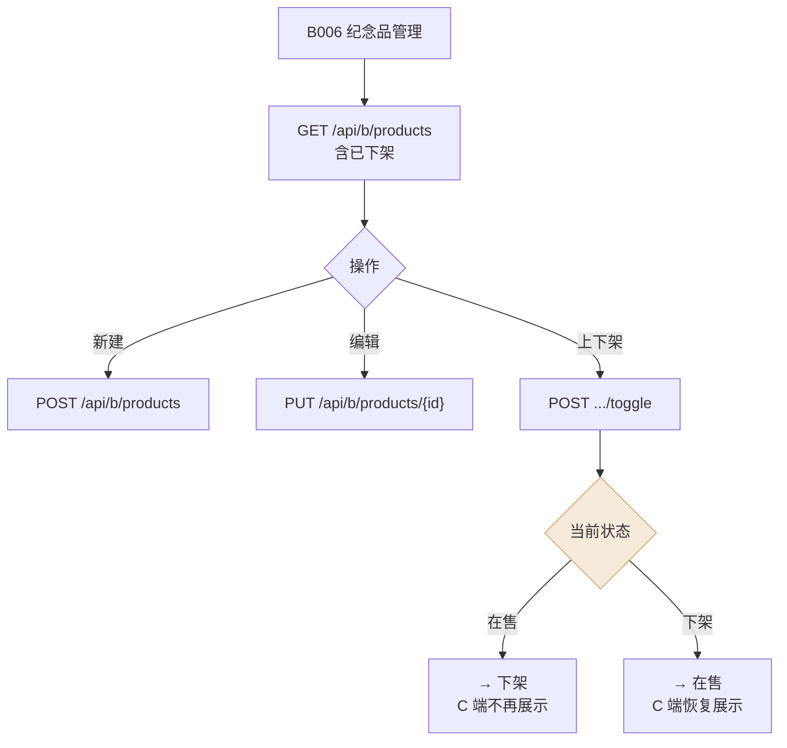

### 3.8 骨灰寄存管理（B007）

寄存是一个**有到期压力的履约流程**——7 天提醒、到期标红、待取回置顶，本质是防止「客户忘了、门店也没人管」。

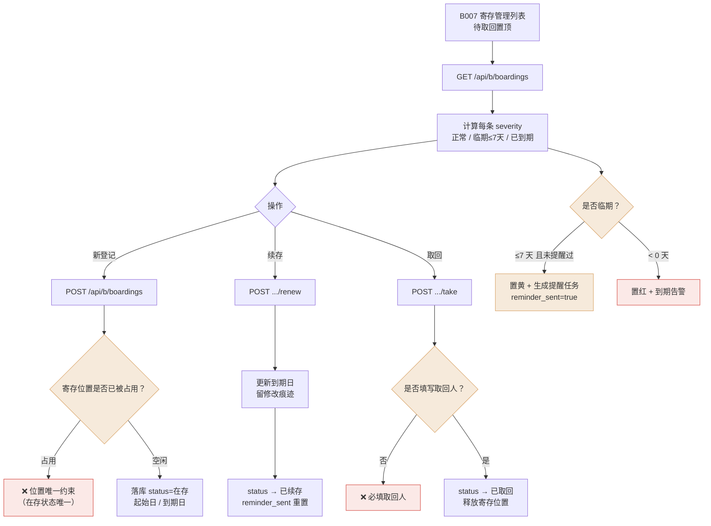

**寄存状态机**

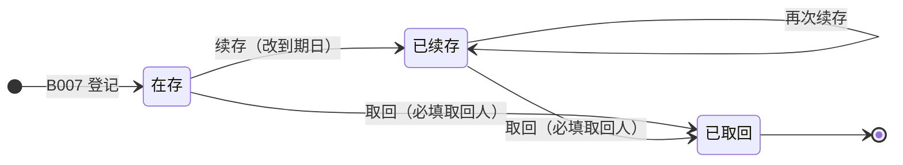

### 3.9 客户档案与回访闭环（B008 / B009）

回访任务是**动态计算**的，不建任务表——订单完成满 30 天自动出现在待回访队列。这是单店场景下用最少的表解决「回访不落空」的取巧做法。

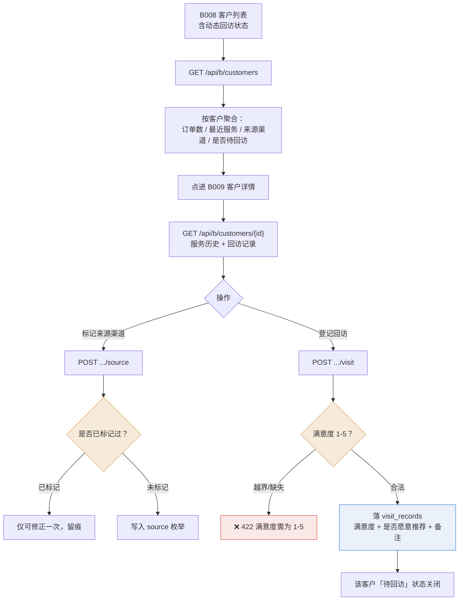

**回访任务生成逻辑**

```mermaid
flowchart LR
    A["订单 status → 已完成"] --> B["记录 completed_at"]
    B --> C{"查询客户列表时<br/>已完成满 30 天<br/>且无回访记录？"}
    C -->|是| D["标记为「待回访」"]
    C -->|否| E["不展示"]
    D --> F{"超过 45 天仍未回访？"}
    F -->|是| G["标记「超期未回访」"]

    style C fill:#F6EADB,stroke:#D9A468
    style F fill:#F6EADB,stroke:#D9A468
    style G fill:#FBE9E7,stroke:#D54941
```

### 3.10 数据看板（B010）

```mermaid
flowchart TD
    A["B010 数据看板"] --> B["GET /api/b/stats"]
    B --> C["月度指标汇总"]
    C --> D["订单量 / 完成量"]
    C --> E["营业额（已结清订单合计）"]
    C --> F["SLA 达成率<br/>（30 分钟内确认占比）"]
    C --> G["夜间单占比"]
    C --> H["转化漏斗<br/>价格页曝光 → 提交预约 → 完成"]

    style B fill:#EAF1FB,stroke:#3B7DD8
```

> 该页面优先级为 **P2**，当前仅做 token 层面的视觉统一，未做深度打磨。

### 3.11 平台层：门店开通与品牌配置（B011，仅超管）

这一层在**任何门店业务发生之前**就要跑完——超管先开店、配品牌、开首位店长账号，那家店才存在，客户才可能扫码进来。它也是「一套小程序服务多家门店」的入口。

```mermaid
flowchart TD
    S(["平台超管登录"]) --> M{"菜单里有什么？"}
    M -->|"只有「门店管理」"| L["B011 门店列表<br/>店名 / C 端标识 / 主色 / 账号数 / 状态"]
    M -.->|"租户角色：没有这一项"| T["只能进自己门店的菜单"]

    L --> A1["点「开通门店」"]
    A1 --> A2["填门店信息<br/>门店名称 + C 端标识 slug"]
    A2 --> A3["填品牌与 UI<br/>对外店名 / 标语 / 主色 / Logo"]
    A3 --> A4["填首位店长账号<br/>账号 + 初始密码 + 姓名"]
    A4 --> A5["POST /api/b/platform/stores"]
    A5 --> A6{"标识是否被占用？"}
    A6 -->|是| R1["❌ 409 门店标识已被占用"]
    A6 -->|否| A7{"登录账号是否已存在？"}
    A7 -->|是| R2["❌ 409 账号已存在"]
    A7 -->|否| A8["建 stores + store_profiles + 店长<br/>一次事务落库"]

    A8 --> D["B011 门店详情"]
    D --> D1["Tab1 品牌与 UI<br/>改店名/标语/主色/Logo → 立即生效"]
    D --> D2["Tab2 门店账号<br/>开号 / 改密 / 停用 / 启用"]

    D1 --> E1["PUT .../profile"]
    E1 --> E2{"入参合法？"}
    E2 -->|"主色非 hex / logo 非路径或 URL / slug 含非法字符"| R3["❌ 422 拒绝入库"]
    E2 -->|通过| E3["C 端 GET /api/c/store/profile?slug=x<br/>即刻返回新店名/新色/新标语"]

    D2 --> F1["POST .../staff<br/>role 只能是店长或店员"]
    F1 --> F2{"role = super_admin？"}
    F2 -->|是| R4["❌ 422 门店内只能创建店长或店员"]
    F2 -->|否| F3["店员自动挂到本店首位店长名下"]

    L --> G1["点「停用」"]
    G1 --> G2["POST .../status = disabled"]
    G2 --> G3["C 端按该 slug 访问一律 404<br/>后台数据与账号全部保留"]
    G3 --> G4["可随时重新启用"]

    style R1 fill:#FBE9E7,stroke:#D54941
    style R2 fill:#FBE9E7,stroke:#D54941
    style R3 fill:#FBE9E7,stroke:#D54941
    style R4 fill:#FBE9E7,stroke:#D54941
    style M fill:#F6EADB,stroke:#D9A468
    style A6 fill:#F6EADB,stroke:#D9A468
    style A7 fill:#F6EADB,stroke:#D9A468
    style E2 fill:#F6EADB,stroke:#D9A468
    style F2 fill:#F6EADB,stroke:#D9A468
    style A8 fill:#EAF1FB,stroke:#3B7DD8
    style E3 fill:#EAF1FB,stroke:#3B7DD8
    style G3 fill:#EAF1FB,stroke:#3B7DD8
```

**接口一览（`/api/b/platform/*`，全部要求超管身份 + 对应平台权限）**

| 方法 | 路径 | 平台权限 | 说明 |
|---|---|---|---|
| GET | `/stores` | `store.manage` | 门店列表（含账号数、店长数、品牌快照） |
| POST | `/stores` | `store.manage` | 开通门店：一次事务建 门店 + 品牌 + 首位店长 |
| GET | `/stores/{id}` | `store.manage` | 门店详情 |
| POST | `/stores/{id}/status` | `store.manage` | 启用 / 停用门店（停用后 C 端 404） |
| GET | `/stores/{id}/profile` | `store.brand` | 读指定门店品牌 |
| PUT | `/stores/{id}/profile` | `store.brand` | 配品牌与 UI（店名/标语/logo/主色） |
| GET | `/stores/{id}/staff` | `store.provision` | 该店账号列表 |
| POST | `/stores/{id}/staff` | `store.provision` | 开门店账号（店长/店员） |
| PUT | `/stores/{id}/staff/{sid}` | `store.provision` | 改名 / 改密 / 改状态 |
| POST | `/stores/{id}/staff/{sid}/disable` | `store.provision` | 停用账号（不能停自己） |

**关键约束**

| 约束 | 落地位置 | 为什么 |
|---|---|---|
| 门店业务操作**必须**显式带 `store_id` | 全部平台路由的路径参数 | `store_id=None` 在 `tenant` 层是「不过滤」，不是特权；靠它取数据会串店 |
| 门店接口不得创建 `super_admin` | `StoreStaffInput.role` 校验 | 否则任何门店都能造出一个平台级账号，直接提权 |
| 品牌写入租户侧恒 403 | `PUT /api/b/store/profile` | 品牌收归平台统一配置，租户连自己那家也不能改（返回明确指引而非 404） |
| 超管菜单只有「门店管理」 | `PLATFORM_MENU_KEYS` + RBAC | 防孤儿数据：超管在无门店上下文时建服务项目/纪念品，`store_id` 会是 `NULL`，任何门店都查不到 |
| 租户角色拿不到平台菜单与权限 | `/api/b/menus`、`/permissions`、`/roles` 全部过滤；`PUT /roles/{key}` 拦 `super_admin` | 堵死「改自己的角色 → 拿到 `store.brand` → 改别人家品牌」这条提权链 |
| 门店标识 `slug` 全局唯一 | `store_profiles.slug` 唯一索引 + 409 | 它是 C 端认店的唯一依据，重了就会串店 |

**C 端换肤链路**

```mermaid
flowchart LR
    A["顾客扫码 / 带 slug 进入"] --> B["小程序存下 slug"]
    B --> C["GET /api/c/store/profile?slug=x"]
    C --> D{"门店存在且在营业？"}
    D -->|不存在 / 已停用| E["404 → 用中性默认品牌"]
    D -->|正常| F["返回 name / slogan / logo_url / primary_color"]
    F --> G["utils/brand.js mergeTheme()"]
    G --> H["整站 --c-primary* 色阶重算<br/>+ tabBar 选中色 + 导航栏标题"]
    H --> I["未配 logo 时用店名首字占位"]
```

> ⚠️ **中性兜底原则**：品牌兜底**不得**回落任何一家门店（或平台）的名字/logo。新门店在拉到资料前的那一帧，如果显示的是别家的品牌，顾客会以为进错了小程序。所以：默认店名是「宠物善终服务」这类中性词，未配 logo 一律用店名首字占位。

---

## 4. 异常与分支流程

### 4.1 四条异常路径

| 场景 | 触发条件 | 系统行为 | 人工兜底 |
|---|---|---|---|
| **联系不上客户** | 待确认 > 2 小时 | B001 置顶提醒；超 15 分钟红色提醒 | 店员第二次外呼；仍失联 → 转「已取消（失联）」必填原因，客户可重新预约 |
| **影像上传持续失败** | 上传报错 | 阻断流转（强制节点未满足） | 需店长权限走「无影像流转」例外通道——**代码中尚未实现**，见 §9 |
| **客户改期** | 免费 1 次 | `reschedule_count` 计数，第 2 次拒绝 | 超次由店长线下处理 |
| **重复下单** | 存在进行中订单 | 提交时 422 拒绝 | 提示客户联系门店 |

### 4.2 三条分支流程

```mermaid
flowchart TD
    S["预约时的分支选择"] --> A{"是否上门接送？"}
    A -->|上门接送| A1["填地址<br/>流转含[接宠中]节点<br/>需接宠完成影像"]
    A -->|到店自送| A2["地址留空<br/>跳过[接宠中]<br/>影像强制节点少一个"]

    S --> B{"下单时间？"}
    B -->|22:00 - 次日 7:00| B1["is_night = true<br/>工作台标红<br/>店员手机订阅消息 + 电话兜底"]
    B -->|其他时段| B2["普通单"]

    S --> C{"是否现场加购纪念品？"}
    C -->|是| C1["交付环节 B003 追加加购项<br/>按追加时刻价格版本计价<br/>重算总额 + 推送客户确认"]
    C -->|否| C2["按原总额结算"]

    style A fill:#F6EADB,stroke:#D9A468
    style B fill:#F6EADB,stroke:#D9A468
    style C fill:#F6EADB,stroke:#D9A468
    style B1 fill:#F6EADB,stroke:#D9A468
    style C1 fill:#EAF1FB,stroke:#3B7DD8
```

> **注意**：「系统不做自动派单」——单店场景，接单即店员本人接到，不需要派单算法的复杂度。这是 ADR 里明确记过的「不做」清单项。

---

## 5. 全系统状态机总表

| 实体 | 状态字段 | 状态集合 | 终态 | 代码位置 |
|---|---|---|---|---|
| 门店（平台层） | `store.status` | 营业中 / 已停用 | — | `app/models/staff.py` |
| 员工 | `staff.status` | 在职 / 停用 | — | `app/models/staff.py` |
| 订单（主） | `order.status` | 待确认 / 已预约 / 接宠中 / 服务中 / 待交付 / 已完成 / 已取消 | 已完成、已取消 | `app/services/order_state.py` |
| 订单（支付） | `order.pay_type` | 未支付 / 定金已付 / 全款已付 / 到店付已结清 | — | `app/models/order.py` |
| 订单（退款） | `order.refund_status` | 无 / 退款中 / 已退款 / 退款失败 | 已退款 | `app/models/order.py` |
| 寄存 | `boarding.status` | 在存 / 已续存 / 已取回 | 已取回 | `app/models/boarding.py` |
| 服务项目 | `service_item.status` | 在售 / 下架 | — | `app/models/service_item.py` |
| 回访 | 动态计算 | 待回访 / 已回访 / 超期未回访 | 已回访 | `app/routes/customers.py` |
| 影像 | `service_media.revoked` | 有效 / 已撤回 | 已撤回 | `app/models/service_media.py` |

### 5.1 状态流转的语义约定

- **终态不可流转**：`已完成` / `已取消` 出边为空数组，任何尝试都会抛 `非 法状态流转`
- **强制影像**：`REQUIRED_MEDIA_TARGETS = {服务中, 待交付}`，服务端查库校验
- **结清前置**：`SETTLED_PAY_TYPES = {全款已付, 到店付已结清}`，未结清不可标完成
- **服务中锁死**：`服务中` 不可取消（已发生服务成本），需线下处理

---

## 6. 端 × 页面 × 接口映射表

### 6.1 C 端小程序

| 页面编号 | 页面 | 实现路径 | 主要接口 | 状态 |
|---|---|:--:|---|:--:|
| C001 | 品牌首页 | `pages/index/index` | — | ✅ |
| C002 | 服务价格表 | `pages/prices/prices` | `GET /api/c/service-items` | ✅ |
| C003 | 服务详情+科普 | — | — | ❌ 未实现 |
| C004 | 预约下单 | `pages/order-create/index` | `POST /api/c/orders` | ✅ |
| C005 | 我的订单 | `pages/order-list/index` | `GET /api/c/orders` | ✅ |
| C006 | 订单进度时间线 | `pages/order-detail/index` | `GET /api/c/orders/{no}`<br/>`GET /api/c/orders/{no}/media` | ✅ |
| C007 | 纪念品展示 | `pages/products/products` | `GET /api/c/products`<br/>`POST /api/c/products/{id}/buy` | ✅ |
| C008 | 骨灰寄存查询 | `pages/boarding-query/query` | `GET /api/c/boardings/query` | ✅ |
| C009 | 宠物档案 | `pages/pets/pets` | `GET /api/c/pets` | ✅ |
| C010 | 个人中心 | `pages/profile/index` | — | ✅ |
| C011 | 预约成功结果页 | `pages/order-success/index` | C012 到店付款确认后携带 `order_no` 跳转 | ✅ |
| C012 | 收银台 | `pages/cashier/index` | C004 提交成功后携带 `order_no`/金额跳转；`PAY_ENABLED=false` 时仅到店付可选 | ✅ 一期已实现 |

**其余 C 端接口**：`POST /api/c/customers`（轻量注册）、`POST /api/c/auth/login`、`GET /api/c/auth/me`、`POST /api/c/notify/wechat`（支付回调）

### 6.2 B 端管理后台

| 页面编号 | 页面 | 实现路径 | 主要接口 | 状态 |
|---|---|:--:|---|:--:|
| — | 登录 | `views/login.vue` | `POST /api/c/auth/login` | ✅ |
| B001 | 今日工作台 | `views/dashboard.vue` | `GET /api/b/orders`（多状态查询） | ⚠️ 部分 |
| B002 | 订单列表 | `views/order/OrderList.vue` | `GET /api/b/orders` | ✅ |
| B003 | 订单详情+服务记录 | `views/order/OrderDetail.vue` | `GET /api/b/orders/{no}`<br/>`POST .../confirm`、`.../transition`<br/>`POST .../reschedule`、`.../settle`<br/>`PUT .../notes` | ✅ |
| B004 | 影像上传（内嵌） | 组件 | `POST /api/b/orders/{no}/media`<br/>`POST /api/b/media/{id}/revoke` | ✅ |
| B005 | 服务项目与价格 | `views/service/ServiceItems.vue` | `GET/POST /api/b/service-items`<br/>`PUT .../{id}`、`POST .../off-sale`<br/>`GET .../versions` | ✅ |
| B006 | 纪念品管理 | `views/product/Products.vue` | `GET/POST/PUT /api/b/products`<br/>`POST .../toggle` | ✅ |
| B007 | 寄存管理 | `views/boarding/Boarding.vue` | `GET/POST /api/b/boardings`<br/>`POST .../renew`、`.../take` | ✅ |
| B008 | 客户档案列表 | `views/customer/CustomerList.vue` | `GET /api/b/customers` | ✅ |
| B009 | 客户详情 | `views/customer/CustomerDetail.vue` | `GET /api/b/customers/{id}`<br/>`POST .../source`、`.../visit` | ✅ |
| B010 | 数据看板 | `views/stats` | `GET /api/b/stats` | ⚠️ P2 |
| **B011** | **门店管理（仅超管）** | `views/platform/StoreList.vue` | `GET/POST /api/b/platform/stores`<br/>`POST .../{id}/status` | ✅ |
| **B011a** | **门店详情：品牌与 UI** | `views/platform/StoreDetail.vue` | `GET/PUT /api/b/platform/stores/{id}/profile` | ✅ |
| **B011b** | **门店详情：门店账号** | 同上（Tab2） | `GET/POST .../{id}/staff`<br/>`PUT .../{id}/staff/{sid}`、`POST .../disable` | ✅ |

---

## 7. 埋点与流程节点的对应

流程里的关键节点都要有埋点兜底，否则「流程跑通了吗」只能靠感觉。

| 流程节点 | 埋点事件 | 参数 | 优先级 |
|---|---|---|---|
| C002 价格表曝光 | `price_page_view` | 来源（首页/分享/搜索） | P0 |
| C004 提交预约成功 | `order_submit` | 套餐 id、是否夜间单、是否带加购意向 | P0 |
| C012 支付成功 | `pay_success` | pay_type、金额、订单 id | P0 |
| B003 确认订单 | `sla_confirm` | 下单到确认耗时（分钟） | P0 |
| B004 影像上传成功 | `node_media_upload` | 订单 id、节点、媒体类型 | P0 |
| C006 时间线曝光 | `timeline_view` | 订单 id、浏览影像张数 | P0 |
| 退款完成 | `refund_done` | 订单 id、金额、触发原因 | P0 |
| C007 曝光 / B003 现场追加 | `addon_view` / `addon_add` | 商品 id、触发场景 | P1 |
| B009 回访登记提交 | `visit_done` | 满意度、是否愿意推荐 | P1 |
| B009 来源标记保存 | `source_tag` | 渠道枚举 | P1 |
| C007 单件直购成功 | `product_buy` | 商品 id、金额、履约方式 | P1 |

---

## 8. 流程中的关键设计决策（为什么这么设计）

| 决策 | 备选方案 | 为什么选它 |
|---|---|---|
| **锁价快照（price_version）** | 实时读当前价 | 客户提交时的价格是不可撤销的承诺；改价不能影响历史订单，否则「透明价格」崩塌 |
| **支付与订单状态解耦** | 支付成功才允许服务流转 | 善终是紧急场景，客户可能先约后付、先服务后付；用支付卡流程会让真实业务跑不动 |
| **影像服务端校验** | 信任前端传 has_media | 强制影像是对客户的承诺；前端可绕过，服务端查库不可绕过 |
| **回访任务动态计算** | 建独立任务表 + 定时生成 | 单店数据量小（<1 万单/年），查询时算比维护任务表更省、也不会漏 |
| **寄存位置唯一约束** | 允许重号后期人工整理 | 位置错乱会导致取错骨灰，这是不可接受的错误，必须数据库层兜住 |
| **不做自动派单** | 派单算法 | 单店场景，接单的就是本人，派单是过度设计 |
| **服务中锁死不可取消** | 允许店长强制取消 | 已发生服务成本，此刻取消会引发纠纷；线下谈妥比线上点按钮更可控 |
| **品牌配置收归平台超管** | 各店自己配（租户自配） | 品牌是「一套小程序对外呈现谁」的承诺面。放开给各店，C 端会变成五花八门的拼贴；且出问题时是平台在背合规责任。超管统一配 = 品牌口径唯一、可追溯 |
| **超管菜单只有门店管理** | 超管能进所有门店的业务页 | 超管没有门店上下文，进租户页建服务项目/纪念品会落 `store_id=NULL`，产生任何门店都查不到的孤儿数据。与其给一个会造脏数据的入口，不如不给 |
| **品牌兜底一律中性** | 兜底回落到平台品牌 | 门店在拉到资料前的那一帧若显示别家的名字/logo，顾客会以为进错小程序。中性占位（店名首字）比「借一个标」更安全 |
| **停用门店而非删除** | 提供删店 | 删店会连带删掉订单/客户资产，误操作不可逆。停用后 C 端 404、数据全留，可随时恢复 —— 用可逆操作覆盖 99% 的真实诉求 |

---

## 9. PRD 与实现差异清单 ⚠️

> 这部分是**本文件最重要的产出**：把设计文档与实际代码的分歧摊开，避免开发、测试、评审各说各话。
> 处理原则：**代码为准**，差异项回写 PRD 作为待办，由产品确认「改代码」还是「改 PRD」。

| # | 差异点 | PRD §6.4 设计态 | 代码实现态 | 影响 | 建议 |
|:--:|---|---|---|---|---|
| 1 | **逆向流转** | 「已完成」原则上不可回退，确需回退由店长操作并强制原因；状态回退全量写审计日志 | `TRANSITIONS` 中**无任何逆向边**；`order_service.transition()` 注释「店长回退例外通道暂不实现」 | 收款纠纷等场景无系统出口，只能改库 | 短期：PRD 标注「v1.0 不实现」；中期：补店长回退边 + 审计日志 |
| 2 | **服务中/待交付取消** | 「任意非终态 → 已取消」，需店长权限 + 必填原因 | `TRANSITIONS[服务中] = [待交付]`、`TRANSITIONS[待交付] = [已完成]`，**均无取消边**；`validate_transition` 还显式拦截 `服务中→已取消` | 服务中出事故（如宠物遗失）无法线上取消 | 明确 PRD：服务中之后只能线下处理；或补店长专用取消边 |
| 3 | **无影像流转例外通道** | 「影像上传持续失败：允许店长权限『无影像流转』，标记例外并记录原因」 | `validate_transition` 中**无例外参数**，`TransitionContext.is_owner` 字段已定义但未被使用 | 网络/设备故障时业务卡死，无兜底 | 补 `is_owner=true` 时跳过影像校验，但强制写审计日志 |
| 4 | **收银台 C012** | v1.3 新增 C012 收银台，三选一（定金/全款/到店付） | 页面已实现；`PAY_ENABLED=false` 时定金/全款置灰，仅到店付可选；微信支付回调仍为商户号开通后的二期能力 | C 端线上支付不可用，但支付选择页闭环已补齐 | 商户号开通后接入 JSAPI 拉起与支付结果回写 |
| 5 | **预约成功页 C011** | 独立页面承载提交反馈 | 已实现 `pages/order-success/index`，C012 到店付款确认后跳转并支持订单号复制/查看订单/返回首页 | 已收口 | 无 |
| 6 | **服务详情页 C003** | 独立页面（P0） | 未实现 | 客户无法看科普内容，信任转化链路缺一环 | 排期补 |
| 7 | **改期接口状态约束** | 「客户改期：免费改期 1 次」（语境在服务前） | `reschedule` 接口**不限状态**，`已完成` 订单也能改 `expect_time`，且消耗改期次数 | 口径漏洞，已交付订单被改时间会造成数据失真 | 补状态白名单：仅 `已预约/接宠中` 可改期 |
| 8 | **客户取消 vs 店员取消** | 两者分列，店员取消需必填原因 | C 端 `cancel` 接口已实现；**B 端无独立取消接口**，只能走 `transition` + `target=已取消` | 店员取消未强制校验原因（`cancel_reason` 不会被写入） | 补 B 端取消接口或让 `transition` 支持写入 `cancel_reason` |
| 9 | **权限校验** | 三角色权限矩阵（店长/店员/宠物主） | 骨架期**信任 `payload.role`**，无 token 鉴权；`b_orders.py` 文件头注释已注明「鉴权中间件接入后从 token 解出」 | **当前任意调用方传 `role=店长` 即可撤回影像** | 上线前必须接入鉴权中间件，这是安全红线 |
| 10 | **自动退款执行** | 取消后原路退回 1-3 个工作日 | `cancel_by_customer` 只把 `refund_status` 置为 `退款中`；`query_and_reconcile()` 有 TODO 未实现 | 退款不会真正执行，会累积待退款单 | 商户号开通后补退款任务 |
| 11 | **多租户已提前落地** | §12.1 定位「单门店」，§12.2 多租户列为「未来方向，当前不实现」 | **已实现**：全部业务表加 `store_id` 行级隔离、按店 slug 进入、跨店数据零共享、平台层 RBAC | 与 PRD 的版本定位不一致（文档说单店，代码是多店） | 回写 PRD：§12.1/§12.2 从「未来」移到「已实现」，并补 §5 平台层功能需求 |
| 12 | **品牌配置的归属** | §12.3 只说「品牌色/logo/头图/承诺文案可配置」，未明确谁配；且写明「不做装修管理界面」 | **已实现配置界面，且归属平台超管**；租户侧写入恒 403；定制项收敛为 4 项（店名/标语/logo/主色），**不含头图** | 若按「各店自配」理解，实现与预期相反；头图能力缺失 | 回写 PRD 明确「品牌由平台统一配置」与 4 项范围；头图另立需求 |
| 13 | **平台超管的可见范围** | §12.2 写「平台管理员角色跨店只看汇总」（隐含能进业务页看汇总） | **超管菜单只有「门店管理」**，进不了订单/客户/看板等租户页 | 「跨店汇总看板」目前不存在；超管看不到经营数据 | 若确实要跨店汇总，需单做 B012 平台经营看板（带门店维度），而不是把超管塞进租户页 |
| 14 | **隔离字段命名** | §12.2 / ADR-006 用 `shop_id` | 实现用 **`store_id`**（表 `stores`、接口 `X-Store-Slug`、白标表 `store_profiles`） | 文档与代码命名不一致，交接时易误解 | 回写 ADR-006 与 PRD：统一改称 `store_id` |

---

## 10. 修订记录

| 版本 | 日期 | 修订人 | 变更内容 |
|---|---|---|---|
| v1.0 | 2026-09-10 | 张孟博 | 首版：梳理 C 端 7 条 + B 端 10 条业务流程、订单/支付/寄存三套状态机、端到端全景图、22 个接口映射、10 项 PRD 与实现差异 |
| v1.1 | 2026-09-12 | 张孟博 | **多租户 + 白标落地**：① §0.1 新增「平台超管」角色与平台/门店双层说明（含 `store_id is None` 的实现红线）；② 新增 §3.11 平台层流程（开店→配品牌→开账号→启停门店）+ 10 个平台接口 + 6 条硬约束 + C 端换肤链路；③ §5 补门店/员工状态；④ §6.2 补 B011/B011a/B011b；⑤ §8 补 4 条设计决策（品牌收归平台、超管不做履约、中性兜底、停用而非删除）;⑥ §9 新增差异项 11-14（多租户提前落地 / 品牌归属与 PRD 记录相反 / 超管可见范围与「跨店汇总」不符 / `shop_id`→`store_id` 命名）；⑦ §11 补平台层与白标源码索引 |

---

## 11. 关联文档

| 文档 | 路径 | 关系 |
|---|---|---|
| PRD | `02-产品文档/pet_xiaoman_PRD_v1.2.md` | 设计态事实源（§6 业务流程、§6.4 状态机） |
| 技术选型方案 | `03-技术文档/pet_xiaoman_技术选型方案_v1.1.md` | ADR-001~006 与技术「不做」清单 |
| C 端设计规范 | `05-UI设计/pet_xiaoman_C端设计规范_v1.0.md` | 页面视觉与交互规范 |
| 项目进度 | `07-其它文档/project-tracker.md` | 任务状态 |
| 行为规范 | `AGENTS.md` | AI 协作宪法 |
| 状态机源码 | `06-项目编码/pet_xiaoman_api/app/services/order_state.py` | 订单状态机唯一真相 |
| 订单业务逻辑 | `06-项目编码/pet_xiaoman_api/app/services/order_service.py` | 五道闸门与锁价 |
| 影像服务 | `06-项目编码/pet_xiaoman_api/app/services/media_service.py` | 强制影像校验入口 |
| 平台层接口 | `06-项目编码/pet_xiaoman_api/app/routes/b_platform.py` | 开店/启停/配品牌/开门店账号（仅超管） |
| 租户隔离 | `06-项目编码/pet_xiaoman_api/app/services/tenant.py` | `scoped()` / `resolve_store_id_by_slug()` / `store_is_active()` |
| 平台鉴权 | `06-项目编码/pet_xiaoman_api/app/dependencies.py` | `require_super_admin` 与平台/门店边界契约 |
| 入参校验 | `06-项目编码/pet_xiaoman_api/app/services/validators.py` | slug / hex 主色 / logo / 标语 唯一事实源 |
| C 端换肤 | `06-项目编码/pet_xiaoman_miniapp/utils/brand.js` | 按门店 slug 拉品牌 → 派生整套色阶 + 中性占位 |
| 后台换肤 | `06-项目编码/pet_xiaoman_admin/src/utils/theme.js` | 主色 → `--px-*` / `--el-color-primary*` |
| 存量库升级 | `06-项目编码/pet_xiaoman_api/scripts/migrate_tenant.py` | 补列 + 平台 RBAC + 枚举归一 + 回填 |
