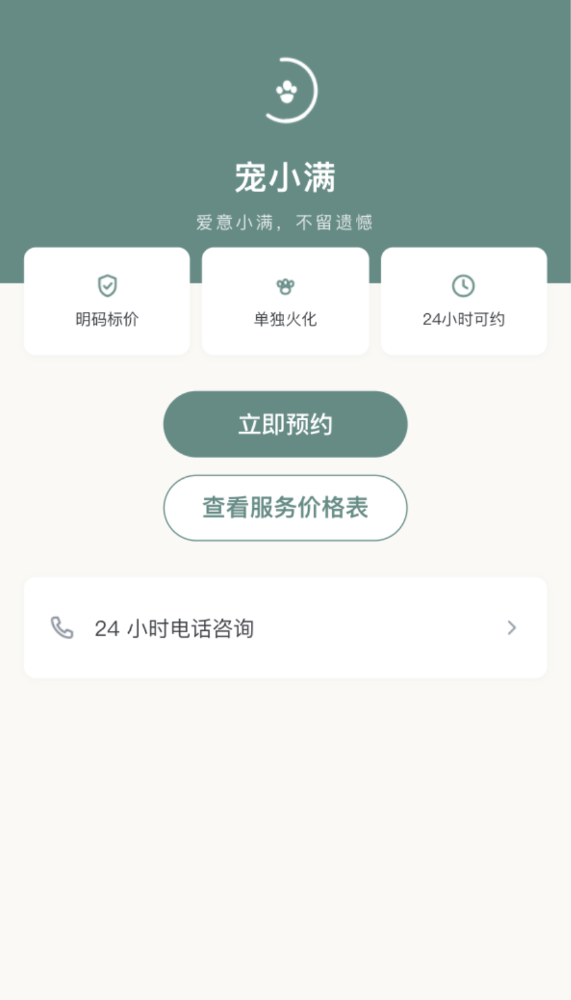
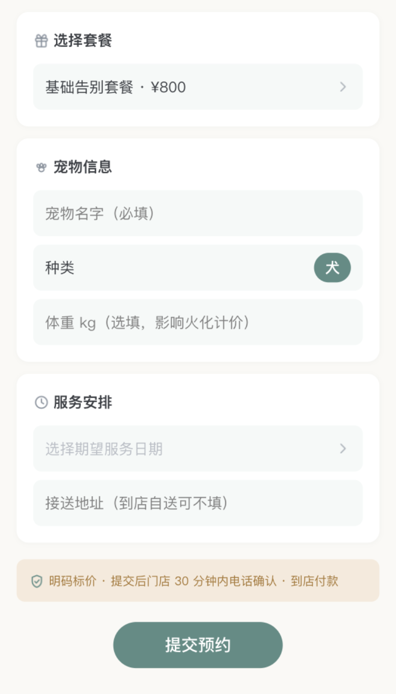

# 宠小满 ChongXiaoMan

> 宠物善终门店**多租户 SaaS**：用一套系统把「预约下单 → 到店服务 → 影像留痕 → 结清交付」的履约全链路管起来，并把「信任」做成可校验的规则。

## 这是什么

面向宠物善终门店的 SaaS：商家在门店后台接单、记录服务节点与影像；宠物主在小程序下单、查看进度；平台方在超管后台做多租户与配置管理。

核心设计是把「信任」落成规则，而不是靠口头承诺：

| 机制 | 作用 |
|---|---|
| 门店级多租户隔离 | 跨店访问一律 404，数据不串店 |
| 三层鉴权 | 角色 - 菜单 - 操作权限，运营调档位不漏权限 |
| 订单状态机 | 状态只能按合法迁移，禁止跳步 |
| 节点影像强制前置校验 | 关键服务节点未传影像不允许进入下一态 |
| 下单锁价快照 | 下单即冻结价格，后续改价不影响已下单 |

## 技术栈

| 端 | 选型 |
|---|---|
| 后端 | FastAPI + SQLAlchemy 2.0 + SQLite（零依赖本地可运行，可切 MySQL/PostgreSQL） |
| 门店后台 | Vue 3 + Vite + Element Plus |
| 小程序 | 微信原生小程序 |
| 平台超管 | 同门店后台，按角色区分菜单 |
| 测试 | pytest（后端 118 项，全绿） |

规模：**86 个业务接口，三端（小程序 / 门店后台 / 平台超管）**。

## 运行截图

> 以下为门店后台 / 小程序真实运行截图（非设计稿），源自本仓库 `05-UI设计/页面走查证据`。

| 今日工作台 / 首页 | 下单创建 |
|---|---|
|  |  |

## 本地启动

```bash
# 1) 后端（默认 8010）
cd 06-项目编码/pet_xiaoman_api
python -m venv .venv && source .venv/bin/activate
pip install -r requirements.txt
python -m uvicorn app.main:app --host 127.0.0.1 --port 8010 --reload
# 验证：http://127.0.0.1:8010/api/healthz

# 2) 门店后台 / 平台超管（另开终端，默认 5173）
cd 06-项目编码/pet_xiaoman_admin
npm install && npm run dev

# 3) 微信小程序
# 用微信开发者工具导入目录 06-项目编码/pet_xiaoman_miniapp
```

```bash
# 后端测试
cd 06-项目编码/pet_xiaoman_api && pytest
```

## 诚实边界（重要）

- **线上支付未接入。** 当前支付仅在「到店付 / 锁价快照」层面做规则与回调验签，未接微信支付商户号，无真实收款。
- **本地可运行，未真实上线。** 用 SQLite 即可零依赖跑通全流程，但生产部署、真实商户、真实小程序审核未走完。
- 简历里写「86 个业务接口 / pytest 118 全绿」均来自本仓库，可现场 `pytest` 复现。

## 项目状态

个人独立项目（2026.08 起），持续迭代。详见仓库 `02-产品文档 / 03-技术文档 / 05-UI设计`。

## 目录结构

```text
pet-xiaoman/
├── 02-产品文档/    # PRD、试运营清单、迭代规划
├── 03-技术文档/    # 业务流程图、技术选型、部署演练
├── 04-品牌设计/    # Logo、品牌手册
├── 05-UI设计/      # 原型、页面走查证据
├── 06-项目编码/
│   ├── pet_xiaoman_api/      # FastAPI 后端
│   ├── pet_xiaoman_admin/    # Vue3 门店后台 / 超管
│   └── pet_xiaoman_miniapp/  # 微信原生小程序
└── 07-其它文档/    # 提审材料、复盘
```
